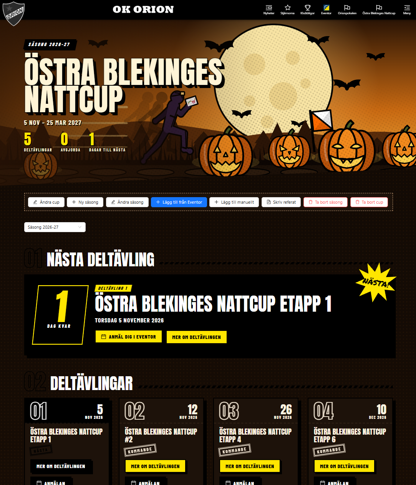
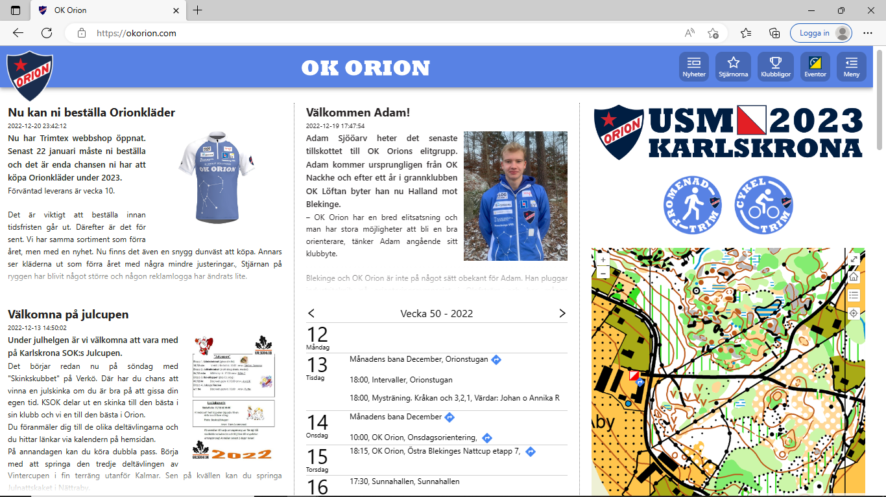
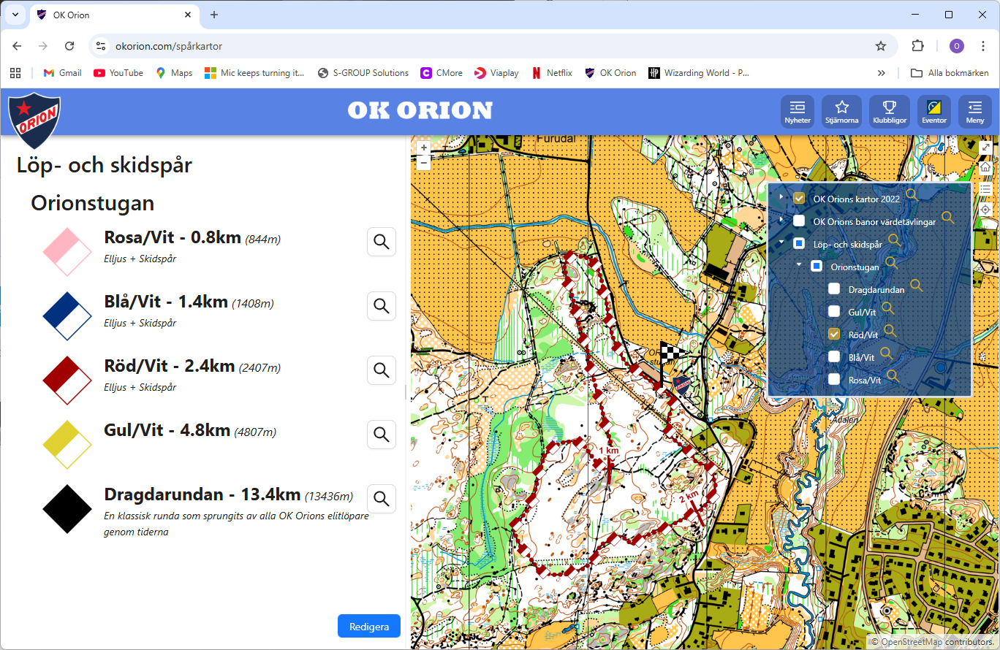
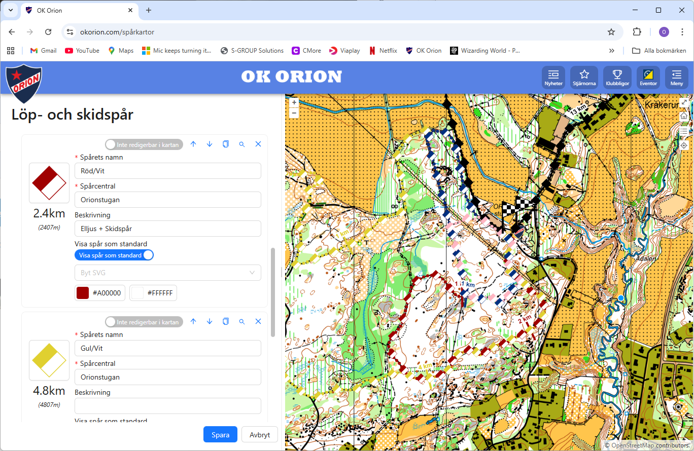
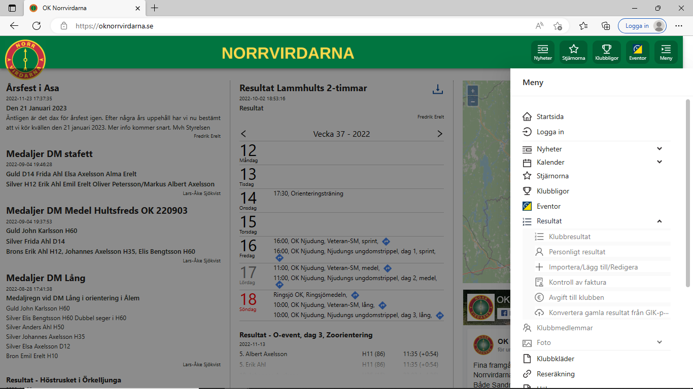
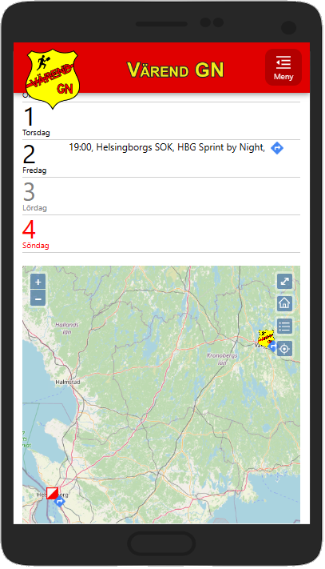
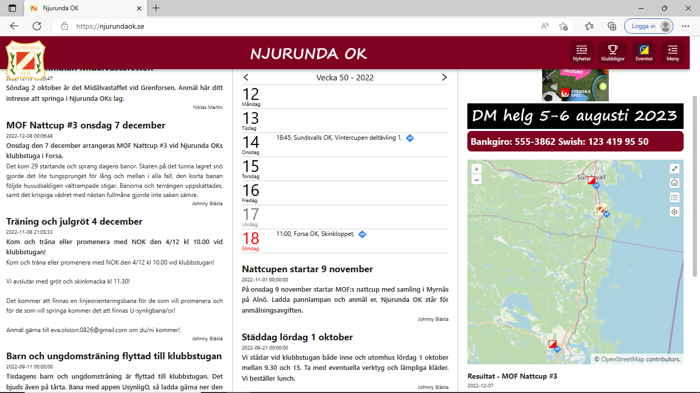

# sportclub 2.4

This is a react app for sports like orienteering or any other sport, with the following key functionality:

- Dashboard, with news, calendar, map, facebook and race results
- News
- Calendar with map connection
- Maps
- Editable tracks with nice markings (and customized if wanted)
- Results with statistics, club/personal list, invoice verification, send invoice to members, and much more
- Member presentation, Stars, where we present each runners personal skils
- Integration to the swedish orienteering fedartion system Eventor (import results)
- Cups, with their own page and theme, seasons, races from Eventor, point systems, standings and race reports (see [Cups](#cups))
- Create/Edit custom webpages (user friendly, and can include images, tables and much more styling), and connect them into the menu
- Create/Edit external links into the menu
- Upload files, and connect them into the menu
- Administrate members

## Cups

Administrate club cups, e.g. a night cup or a youth cup, where every cup gets its own page.



- **Own page and theme** - every cup has its own address (`/cup/nattcupen`) and a comic book / graphic novel theme: Night, Halloween, Youth, Winter, Summer, Spring and Autumn. The colors of the cup can be changed, the club colors are available as presets. A race can have its own theme, and on the cup page the theme of the next race is used (e.g. a halloween premiere).
- **Seasons** - limited in time, all races must be within the dates of the season. The cup page shows the season closest in time.
- **Races** - chosen from Eventor (also the total result after a stage instead of the stage result), or added manually.
- **Categories of classes** - e.g. All, Youth classes, Beginners, with class patterns like `H1*`, one standing per class or one for the whole category, the order of the classes, and age limits (counted as in the orienteering classes, the year the season starts minus the year of birth).
- **Point systems** - points per position (20, 17, 15, ...), fixed points for the winner, based on the number of starters, run to 1000, time behind the winner or percent of the winner time. Lowest points, points for not approved and decimals.
- **Participants** - only the club members or everyone. With only club members, the positions for the points can be among everyone in the class or only among the club members. Participants from other clubs are only saved in the cup, never in the result tables of the club.
- **Counting** - max number of races counted in the season, and extra points for every additional finished race.
- **Results** - in first hand from the results the club already has imported. A race in the result import can be linked to one or more cup races, and the results are then saved to the cups automatically. Results can also be fetched from Eventor (all participants), or added and changed manually.
- **Standings** - a podium for the top three, a column per race with the counted points, and the same person is recognized over the whole season (also when entered on site without an Eventor id).
- **Reports with images** - for every race and for the whole season.
- **Eventor links** - entry for the next races, and the results for the finished races.
- **Menu and toolbar** - every cup in the menu, and optionally as a button in the toolbar. The night themes give a black toolbar with the club logo in grayscale.

To use the cups, add the `Cup` module to your club config file:

```ts
{
  name: 'Cup',
  addUrl: 'https://yourclub.com/cup/save.php',
  deleteUrl: 'https://yourclub.com/cup/delete.php',
  updateUrl: 'https://yourclub.com/cup/save.php',
  queryUrl: 'https://yourclub.com/cup/jsonCupQuery.php'
}
```

## License

This project is licensed under the GNU General Public License v2.0 (GPL-2.0).
See the LICENSE file for details.

## Contribute

It's free to use this as you like, but I will be happy if:

- You pay a small amount for all the time spent. 40000+ lines of code and 900+ hours. Swish between 50 SEK and 3500 SEK to 0723-750908 (Patrik Sjökvist).
- If you contribute with some development or testing.

## Clubs using sportclub / Samples

- [OK Orion](https://okorion.com/)
- [OK Norrvirdarna](https://oknorrvirdarna.se/)
- [Värend GN](https://varendgn.se/)
- [Njurunda OK](https://njurundaok.se/)








_Please email patrik@sjokvistarna.se if your club has started to use this great webpage._

## Visual Studio Code Setup

Download font "Fira Code" and use font ligatures, for a nice look and feel.

I use the following extensions

- ESLint
- Prettier - Code formatter
- Javascript (ES6) code snippets
- Simple React Snippets
- npm Intellisence
- Version Lens
- Bracket Pair Colorizer

and the following seetings:

```json
{
  "git.autofetch": true,
  "[php]": {
    "files.encoding": "utf8"
  },
  "[javascript]": {
    "editor.formatOnSave": true,
    "files.encoding": "utf8"
  },
  "versionlens.showDependencyStatusesAtStartup": true,
  "versionlens.showTaggedVersionsAtStartup": true,
  "prettier.printWidth": 120,
  "editor.codeActionsOnSave": {
    "source.fixAll.eslint": true
  },
  "git.confirmSync": false,
  "[javascriptreact]": {
    "editor.formatOnSave": true,
    "files.encoding": "utf8",
    "editor.defaultFormatter": "esbenp.prettier-vscode"
  },
  "eslint.format.enable": true,
  "extensions.ignoreRecommendations": true,
  "editor.fontFamily": "Fira Code",
  "editor.fontLigatures": true,
  "editor.formatOnSave": true
}
```

## Howto get it up and running

1. You need a webhost that's supporting
   - PHP
   - MySql with InnoDB
2. Create all tables (within "mysql" folder). Create the cup tables (`cupTables.sql`) after the file and result tables, they refer to them. If you already have a database, run the patches in "mysql/patches" that you haven't run yet (e.g. `sportclub_patch_2.4.sql` and `sportclub_patch_2.5.sql` for the cups).
3. Copy all php scripts (within "php" folder) to your public html root folder
4. If you **not** using https://eventor.orientering.se/ as authorization provider (used by all orienteering clubs in sweden), you may need to update the following login files.
   - php/log_in.php
   - php/log_out.php
   - php/include/users.php
5. Create your own club config file in the "src/models/clubs" folder.
6. Change "src/App.tsx" to import your config instead. (import clubJson from './models/clubs/...';)
7. npm install
8. npm run build (or "npm run start" to just start it locally)
9. Copy "index.html" and "static" folder from the "dist" folder to your public html root folder.
10. Done!!

## Make tiled open streetmap images from Ocad

For this task I uses three programs

- OCad orienteering
- GIMP
- QGIS

First export from OCad:

1. Transform map
   - Rotate map to zero degrees, if it's rotated
   - Change coordinate system to Google Mercator (WGS84)
2. If you exporting course do the following
   - Add a grey boxarea where you put the results (purple text)
3. Export PNG
   - Include georeference file
   - 1,0m / pixel (0,5m / pixel for courses)

GIMP (map):

1. Remove surrounding areas that doesn't belong to the map and make them 100% transparent
2. Save
3. Copy that file (and the georeference file) to a purple only png file.
4. Open the purple only png file
   1. Colors > Adjust Contrast to -127
   2. Colors > Adjust Balance magenta (rgb 255, 0, 255) to -100
   3. Colors > Color to alpha (color: white, opacity threshold: 0,015)
   4. Select by color
   5. Edit stroke 20px (line color: rgb 132, 0, 142)
5. Save

GIMP (course):

1. Colors > Color to alpha (color: white, opacity threshold: 0)
2. Colors > Adjust Contrast to +127
3. Colors > Color to alpha (color: white, blending opacity: 20,0)

QGIS:

1. Add png file(s)
   - Drag it into map
   - (Use openstreetmap layer to see that your layer ends up correctly)
   - Edit properities for map layer
     - Symbology > Set min scale to 1:20000
     - Rendering > Resampling Cubic + Oversampling 4,0
   - Edit properities for purple map layer
     - Symbology > Set max scale to 1:20000
     - Rendering > Resampling Cubic + Oversampling 4,0
   - Edit properities for course layer
     - Rendering > Resampling Linear + Oversampling 4,0
2. Raster > Generate XYZ tiles
   - Only show the layers you want to export (all maps at once, or one course layer at a time)
   - Extent > By your layer is a simple choice
   - Minimum zoom: 7 (12 for course layer)
   - Maximum zoom: 17
   - Set Output directory
3. You can remove \*.png files that are totally empty (1,21 kB)
